# Lookout

[](https://packagist.org/packages/nikolai-vysotskyi/lookout)
[](https://packagist.org/packages/nikolai-vysotskyi/lookout)
[](https://github.com/nikolai-vysotskyi/lookout/actions/workflows/tests.yml)
[](https://packagist.org/packages/nikolai-vysotskyi/lookout)
[](https://laravel.com)
[](LICENSE)

<picture>
  <source media="(prefers-color-scheme: dark)" srcset="docs/images/screenshots/dashboard-dark.png" />
  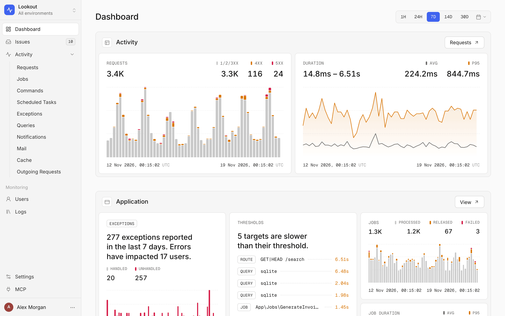
</picture>

Lookout is an open-source, self-hosted alternative to Laravel Nightwatch. It is a monitoring UI that runs inside your Laravel app and reads the telemetry that the [NightOwl agent](https://github.com/lemed99/nightowl-agent) (`nightowl/agent`, MIT) writes to your own PostgreSQL. You get requests with per-request traces, jobs, queries with N+1 detection, exceptions grouped into issues you can assign and comment on, logs, and an MCP server so coding agents can read the same data. The telemetry never leaves your servers, and there is no per-event bill.

## Contents

- [Features](#features)
- [Why Lookout](#why-lookout)
- [How it compares](#how-it-compares)
- [Requirements](#requirements)
- [Installation](#installation)
- [Configuration](#configuration)
- [MCP server](#mcp-server)
- [Development](#development)

## Features

<table>
<tr>
<td width="50%" valign="top">
<a href="docs/images/screenshots/request-trace.png">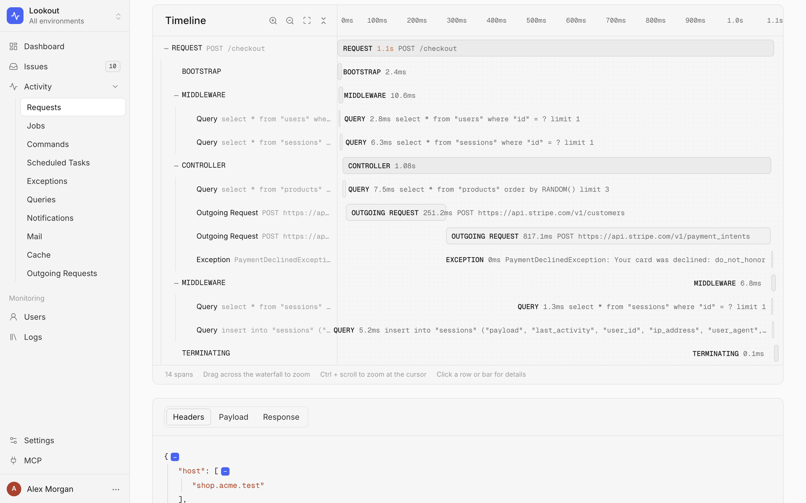</a>
<b>Requests and traces.</b> Each route with its p95, error rate and slowest calls. A request opens as a trace: queries, cache events, outgoing HTTP calls, mail, logs and exceptions on one timeline.
</td>
<td width="50%" valign="top">
<a href="docs/images/screenshots/queries.png">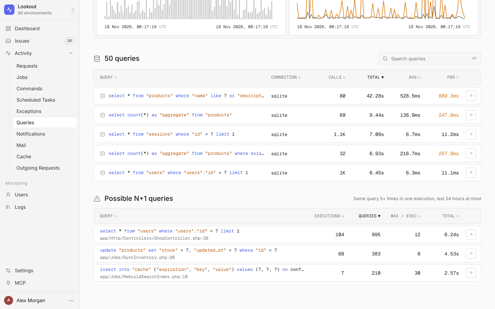</a>
<b>Queries.</b> The slowest and most frequent statements, per connection, with N+1 detection.
</td>
</tr>
<tr>
<td width="50%" valign="top">
<a href="docs/images/screenshots/issue.png">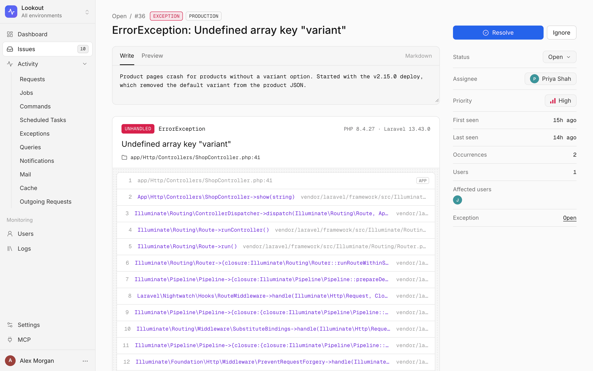</a>
<b>Issues.</b> Exceptions and slow executions grouped into issues with status, priority, assignee, description, comments and an activity history.
</td>
<td width="50%" valign="top">
<a href="docs/images/screenshots/issues.png">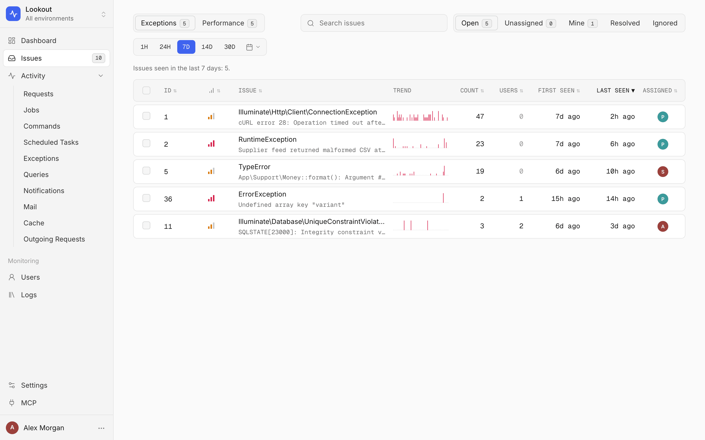</a>
<b>Triage.</b> Filters for open, unassigned and your own issues, bulk actions, and automatic resolve after 7, 14 or 30 quiet days.
</td>
</tr>
<tr>
<td width="50%" valign="top">
<a href="docs/images/screenshots/jobs.png">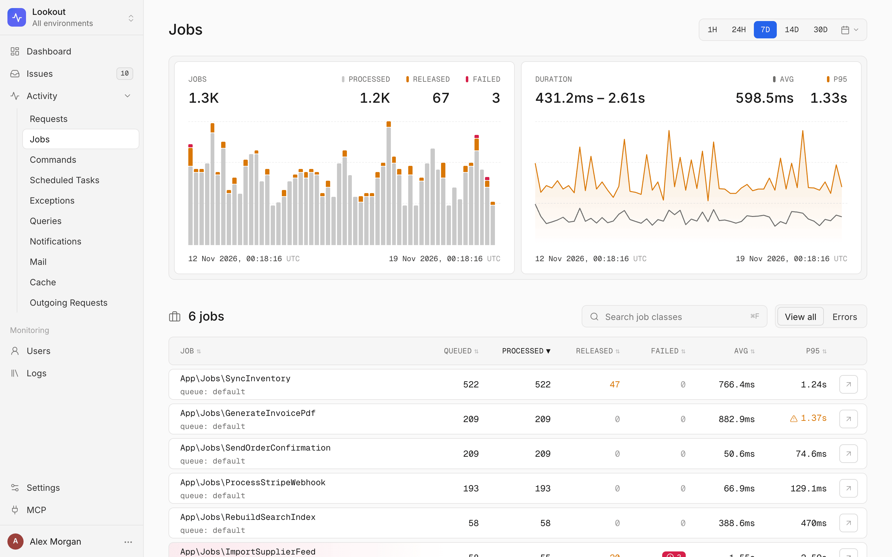</a>
<b>Jobs, commands and scheduled tasks.</b> Attempts, failures, releases and durations, plus every run of a command or task.
</td>
<td width="50%" valign="top">
<a href="docs/images/screenshots/logs.png">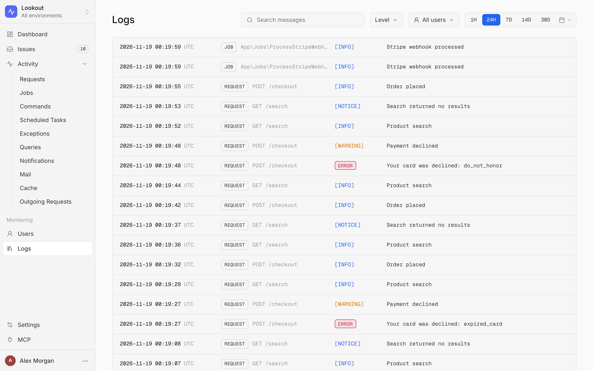</a>
<b>Logs.</b> Filter by level, text and user. Each entry links to the request or job that wrote it.
</td>
</tr>
<tr>
<td width="50%" valign="top">
<a href="docs/images/screenshots/route.png">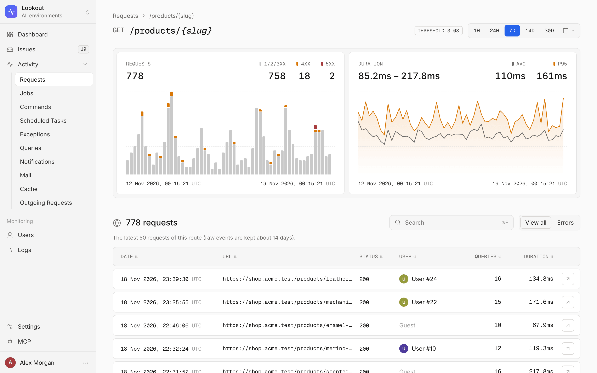</a>
<b>Routes.</b> Status codes, average and p95 over time, the threshold that applies, and the latest calls with their user and query count.
</td>
<td width="50%" valign="top">
<a href="docs/images/screenshots/users.png">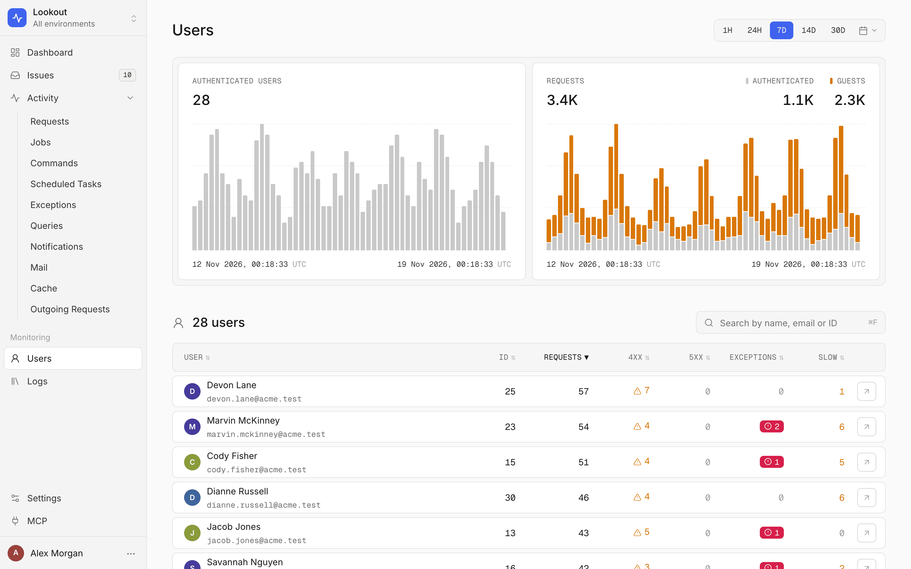</a>
<b>Users.</b> Who is active, and who runs into errors or slow requests. One user opens with their requests, exceptions and logs.
</td>
</tr>
<tr>
<td width="50%" valign="top">
<a href="docs/images/screenshots/settings.png">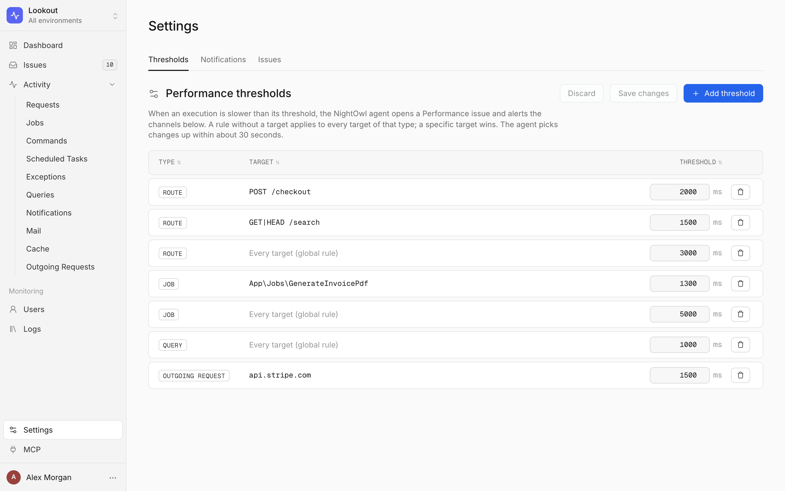</a>
<b>Settings.</b> Performance thresholds per route, job, query and other types. Alert channels: webhook (HMAC-signed), Slack, Discord.
</td>
<td width="50%" valign="top">
<a href="docs/images/screenshots/mcp.png">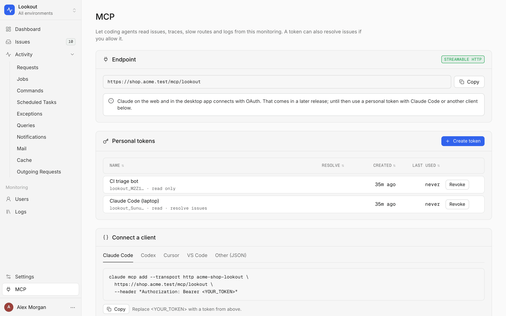</a>
<b>MCP server.</b> Personal tokens and ready-to-paste setup for Claude Code, Codex, Cursor and VS Code.
</td>
</tr>
</table>

Also included:

- **Dashboard.** Requests, errors, latency (avg / p95) and throughput over 1 hour to 30 days, or a custom range, per environment.
- **Exceptions** ([screenshot](docs/images/screenshots/exceptions.png)). Grouped by fingerprint, with the stack trace (your frames marked, vendor frames folded) and the requests or jobs they came from.
- **Mail, notifications, cache and outgoing HTTP.** Volumes, failures and timings.
- **Nova mode.** Reuse Laravel Nova's login and add a sidebar link.
- **No build step.** The SPA ships prebuilt. Your app needs no npm.
- **Phone-friendly.** The whole UI works on a small screen.

<p>
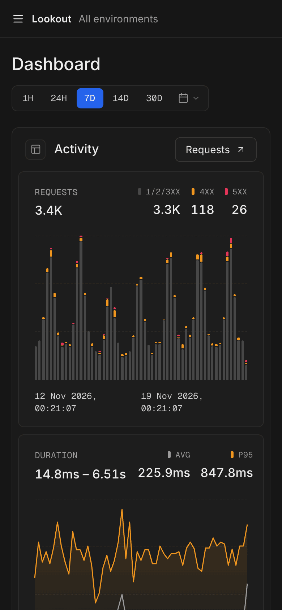
&nbsp;
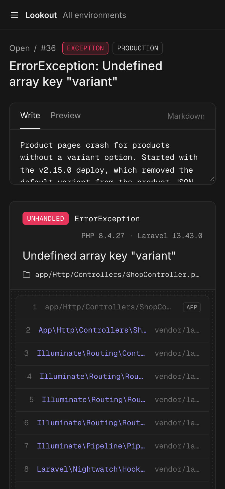
</p>

The screenshots come from a demo shop with generated traffic. No real users or data are shown.

## Why Lookout

- **Your data stays with you.** Telemetry goes from your app to the NightOwl agent and into your PostgreSQL. Lookout reads it from there. No third-party service sees your requests, SQL or stack traces.
- **No event quota.** What you keep is limited by your disk and the NightOwl retention settings, not by a plan.
- **Same instrumentation as Nightwatch.** NightOwl builds on `laravel/nightwatch`, so you get the same request, job, query and exception data.
- **Issues, not only charts.** Errors and slow executions become issues with an owner, a priority and a history.
- **Agent access on your terms.** The MCP server runs in your app, behind your gate, with personal tokens that are read-only unless you allow resolving.
- **Small footprint.** One Composer package, one extra table, no Node, no extra service besides the agent NightOwl already needs.

## How it compares

Facts as stated in each project's own documentation, checked in November 2026. A dash means the linked documentation does not list the feature.

| | Lookout | [Laravel Nightwatch][nw] | [Laravel Pulse][pulse] | [Laravel Telescope][telescope] | [Sentry][sentry] | [Flare][flare] |
|---|---|---|---|---|---|---|
| Hosting | Self-hosted, inside your app | Managed service ([FAQ][nw-pricing]) | Self-hosted, inside your app | Self-hosted, inside your app | Managed service, or self-hosted ([docs][sentry-self]) | Managed service |
| Source code | MIT | Agent package MIT; the service is not open source | MIT | MIT | Self-hosted edition under the FSL ([docs][sentry-self]) | – |
| Pricing model | Free | Free tier, then monthly plans by event volume ([pricing][nw-pricing]) | Free | Free | Free tier, then plans by usage ([pricing][sentry-pricing]); self-hosted is free | Monthly plans by errors, spans and logs, with a trial ([pricing][flare-pricing]) |
| Where data is stored | Your PostgreSQL | Nightwatch data centers in the US and EU ([FAQ][nw-pricing]) | Your MySQL, MariaDB or PostgreSQL | Your database | Sentry's cloud, or your servers | Flare's cloud |
| Per-request traces | Yes | Yes | – (aggregated cards) | Yes (entries per request) | Yes | Yes |
| Exceptions | Yes | Yes | Yes (counts per class and location) | Yes | Yes | Yes |
| Issue workflow (status, comments) | Yes, plus assignee and priority | Yes ([MCP docs][nw-mcp]) | – | – | Yes ([docs][sentry-issues]) | Yes ([docs][flare-errors]) |
| Logs | Yes | Yes | – | Yes | Yes | Yes |
| MCP server for AI agents | Yes, self-hosted | Yes, hosted ([docs][nw-mcp]) | – | – | Yes ([docs][sentry-mcp]) | Yes ([docs][flare-mcp]) |
| Meant for production | Yes | Yes | Yes | Mainly local development ([docs][telescope]) | Yes | Yes |

Lookout and Nightwatch capture with the same `laravel/nightwatch` instrumentation. Pick Nightwatch if you want a managed service with nothing to run. Pick Lookout if the data has to stay on your servers or you want to avoid a per-event bill. Pulse and Telescope are free and complement both: Pulse for at-a-glance aggregates, Telescope for local debugging.

[nw]: https://nightwatch.laravel.com
[nw-pricing]: https://laravel.com/nightwatch/pricing
[nw-mcp]: https://nightwatch.laravel.com/docs/mcp-server
[pulse]: https://laravel.com/docs/pulse
[telescope]: https://laravel.com/docs/telescope
[sentry]: https://sentry.io
[sentry-pricing]: https://sentry.io/pricing/
[sentry-self]: https://develop.sentry.dev/self-hosted/
[sentry-mcp]: https://mcp.sentry.dev/
[sentry-issues]: https://docs.sentry.io/product/issues/issue-details/
[flare]: https://flareapp.io
[flare-pricing]: https://flareapp.io/pricing
[flare-mcp]: https://flareapp.io/docs/flare/general/our-mcp-server
[flare-errors]: https://flareapp.io/docs/flare/errors/working-with-errors

## Requirements

- PHP 8.3+
- Laravel 12 or 13
- PostgreSQL for the NightOwl database
- [`nightowl/agent`](https://github.com/lemed99/nightowl-agent) 2.4+, installed and running. It is a dependency of Lookout. NightOwl builds on the `laravel/nightwatch` instrumentation and stores what it captures in your database.
- Optional: `laravel/mcp` for the MCP server, `laravel/nova` 5 for Nova mode.

## Installation

```bash
composer require nikolai-vysotskyi/lookout
```

1. **Set up NightOwl** as its documentation describes: a PostgreSQL database, `NIGHTOWL_ENABLED=true`, `NIGHTOWL_DB_*`, then `php artisan nightowl:migrate` and a running `php artisan nightowl:agent`. Schedule `nightowl:prune` so its retention settings apply.

2. **Publish the config** (optional, the defaults work) and run the migration. It adds one table, `lookout_mcp_tokens`:

   ```bash
   php artisan vendor:publish --tag=lookout-config
   php artisan migrate
   ```

3. **Define who may open Lookout.** Without this gate nobody gets in.

   ```php
   // app/Providers/AppServiceProvider.php
   use Illuminate\Support\Facades\Gate;

   public function boot(): void
   {
       Gate::define('viewLookout', fn ($user) => $user->is_admin);
   }
   ```

4. **Open `/lookout`.** Lookout is on while `nightowl.enabled` is on. It answers 404 otherwise.

### Reading connection

Lookout reads through the `nightowl_read` connection. If `config/database.php` does not define it, Lookout builds one from `nightowl.database`. Define it yourself to use a separate, less privileged role. That role needs:

- `SELECT` on the NightOwl tables;
- `UPDATE` on `nightowl_issues` and `INSERT` on `nightowl_issue_activity` and `nightowl_issue_comments`, for issue edits;
- writes on `nightowl_settings` and `nightowl_alert_channels`, for the Settings page.

### Nova mode

If your admins already sign in to Laravel Nova, Lookout can sit behind Nova's own stack:

```php
// config/lookout.php
'auth' => 'nova',
```

In Nova mode:

- Lookout uses `nova.api_middleware` on `nova.domain`, so it goes through Nova's login and gate.
- Guests are sent to the Nova login.
- The user menu links back to Nova and signs out of Nova.
- The `viewLookout` gate still decides who gets in.

To add a sidebar link:

```php
use Lookout\Nova\LookoutMenu;

Nova::mainMenu(fn () => [
    // ...
    LookoutMenu::make(), // or LookoutMenu::make('Monitoring', 'lightning-bolt')
]);
```

### Assets

Lookout serves its prebuilt `app.js` and `app.css` from the package at `/{path}/assets/*`, behind the same access check. To serve them from `public/` instead:

```bash
php artisan vendor:publish --tag=lookout-assets
```

The published copy in `public/vendor/lookout` wins while it exists. Re-publish after each update.

## Configuration

All keys live in `config/lookout.php`.

| Key | Default | What it does |
|-----|---------|--------------|
| `enabled` | `null` | `null` follows `nightowl.enabled`. `false` closes Lookout (404) and pauses its schedule. |
| `path` | `lookout` | URL prefix: `/{path}`, `/{path}/api/*`, `/{path}/assets/*`. |
| `domain` | `null` | Restricts Lookout to one domain. In Nova mode, `nova.domain` is used. |
| `auth` | `gate` | `gate` uses `middleware` plus the gate. `nova` uses Nova's API stack plus the gate. |
| `middleware` | `['web', 'auth']` | The stack in `gate` mode. |
| `gate` | `viewLookout` | The ability checked on every page and API call. |
| `connection` | `nightowl_read` | The connection that reads the NightOwl database. |
| `user_model` | `null` | Model behind assignees, comments and tokens. `null` means `auth.providers.users.model`. |
| `title` | `Lookout` | Browser tab title. |
| `brand` | `Lookout` | Name in the sidebar. `null` shows `app.name`. |
| `home`, `logout_url`, `login_url` | `null` | User menu links outside Nova mode. |
| `storage_prefix` | `lookout-` | localStorage prefix for theme, period and environment. |
| `auto_resolve.schedule`, `auto_resolve.at` | `true`, `03:40` | Daily `lookout:auto-resolve` while Lookout is enabled. |
| `mcp.*` | see below | The MCP server. |

To keep auto-resolve days next to your other settings, bind your own `Lookout\Contracts\SettingStore`. The default store uses `nightowl_settings`.

To narrow who issues can be assigned to, set a scope. The default is every user the gate lets in:

```php
use Lookout\Lookout;

Lookout::assignableUsersUsing(fn ($query) => $query->where('role', 'admin'));
```

## MCP server

With `laravel/mcp` installed, Lookout serves an MCP server at `/mcp/lookout`. It has these tools:

| Tool | What it does |
|------|--------------|
| `list_issues` | Issues by status, type and environment, the most recently seen first. |
| `get_issue` | One issue with its counts and the stack trace of its latest occurrence. |
| `slow_routes` | Routes by p95, average, calls or error rate over a window. |
| `slow_queries` | Queries by p95, total time, average or calls. |
| `failed_jobs` | Jobs with failures over a window. |
| `resolve_issue` | Marks an issue resolved. This is the only tool that writes. |

**Access.** Each user creates personal tokens on the MCP page in Lookout. The page also shows ready-to-paste snippets for Claude Code, Codex, Cursor and VS Code.

- A token acts as its owner while the owner passes `mcp.gate`. `null` means the app's gate.
- A token is read-only unless its owner allows "can resolve".
- `LOOKOUT_MCP_TOKEN` with `LOOKOUT_MCP_USER_ID` is a shared token for automation. It acts as that user and may resolve.
- Other credentials of your app (API keys, OAuth tokens) are refused.
- Requests are limited per credential (`mcp.per_minute`, 600 by default).

| Key | Default |
|-----|---------|
| `mcp.enabled` | `true` |
| `mcp.path` | `mcp/lookout` |
| `mcp.gate` | `null` (the app's gate) |
| `mcp.token`, `mcp.user_id` | `LOOKOUT_MCP_TOKEN`, `LOOKOUT_MCP_USER_ID` |
| `mcp.per_minute`, `mcp.rate_limiter` | `600`, `lookout-mcp` |
| `mcp.tokens_table`, `mcp.token_prefix` | `lookout_mcp_tokens`, `lookout_` (12 characters at most) |
| `mcp.server_name`, `mcp.client_name`, `mcp.app_name` | derived from `app.name` |

## Development

```bash
composer install
composer test        # Pest on Orchestra Testbench
sh bin/build.sh      # rebuilds dist/ from resources/js and resources/css
```

The SPA is plain JavaScript split into `resources/js/01..09-*.js`. `bin/build.sh` concatenates the files into `dist/app.js`, so no bundler is needed. Commit `dist/` together with the sources: a test fails if they differ.

See [CONTRIBUTING.md](CONTRIBUTING.md) for pull requests and [SECURITY.md](SECURITY.md) for reporting vulnerabilities.

## Supported by

<a href="https://assetfeed.com/search">
  <picture>
    <source media="(prefers-color-scheme: dark)" srcset="docs/images/sponsors/assetfeed-dark.svg" />
    
  </picture>
</a>

Built by the team behind [AssetFeed](https://assetfeed.com/search).

## License

MIT. See [LICENSE](LICENSE).

---

Lookout is not affiliated with or endorsed by Laravel. Laravel and Laravel Nightwatch are trademarks of their respective owners.
